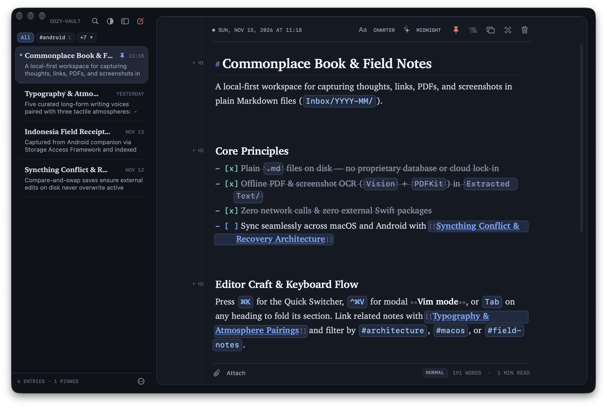
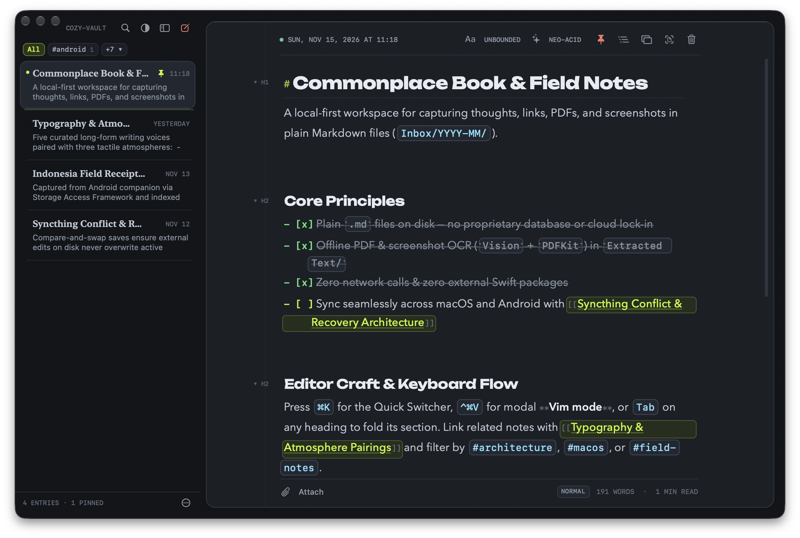

# Cozy Notes

**A local-first macOS commonplace book and Android capture companion built on plain Markdown files, offline OCR, and zero external dependencies.**

[](https://github.com/rizafahmi/cozy-notes/actions/workflows/ci.yml)
[](https://github.com/rizafahmi/cozy-notes/releases/tag/v0.1.0)
[](LICENSE)

Save text, links, files, and screenshots without choosing a title or maintaining folder hierarchies. Find them later using the words you remember.

Notes (`Inbox/<UTC-timestamp>-<UUID>.md`), attachments (`Attachments/<UUID>/`), and extracted PDF/screenshot sidecars (`Extracted Text/<sha256>.md`) are ordinary local files synced externally (for example via [Syncthing](https://syncthing.net/)). Search and extraction use no LLM, account, API key, paid service, or network request.

---

## Atmospheres & Workspace

Cozy Notes is designed as a tactile commonplace book: an index desk on the left with lifted index slips and `#tag` filters, paired with an inset journal folio page on the right featuring `H1`–`H3` gutter badges, subtree folding, a document outline rail, and a ~640pt reading column.

### Obsidian & Ivory (`⌘⇧T`)


### Midnight Ink & Porcelain (`⌘⇧T`)


### Neo-Acid & Plaster (`⌘⇧T`)


---

## Install (macOS 14.0+ · Apple Silicon `arm64`)

Pre-built GitHub releases are packaged as [`Cozy-Notes-v0.1.0-macOS-14.0-arm64.zip`](https://github.com/rizafahmi/cozy-notes/releases/tag/v0.1.0) alongside a matching `.sha256` checksum file:

1. **Download and verify the checksum:**
   ```sh
   shasum -a 256 -c Cozy-Notes-v0.1.0-macOS-14.0-arm64.zip.sha256
   ```
2. **Extract and install:** Extract the archive using Archive Utility (double-click in Finder) or `ditto -x -k Cozy-Notes-v0.1.0-macOS-14.0-arm64.zip .`, then drag **`Cozy Notes.app`** into **`/Applications`**.
3. **First-launch security (ad-hoc signed builds):** Pre-App-Store builds are locally ad-hoc signed (`Signature=adhoc`) rather than Developer ID notarized. When downloaded via a browser, macOS attaches `com.apple.quarantine` and Gatekeeper blocks the first double-click launch:
   - Try to open `/Applications/Cozy Notes.app` in Finder, then open **System Settings → Privacy & Security**, scroll down to the **Security** section where *"Cozy Notes" was blocked from use because it is not from an identified developer* appears, click **Open Anyway**, and confirm with Touch ID or your login password. (On macOS 14 Sonoma, **Control-click → Open** in Finder also presents an **Open** confirmation dialog.)
   - Do **not** disable Gatekeeper globally (`sudo spctl --master-disable`).
4. **Updating:** Quit **Cozy Notes** (`⌘Q`), verify and extract the new release ZIP, and replace `/Applications/Cozy Notes.app` in Finder. Your notes folder, `Attachments/`, `Extracted Text/`, recovery checkpoints (`~/Library/Application Support/CozyNotes/History/`), and `local.cozy.notes` preferences live outside the app bundle and remain untouched.

---

## Key Features & Shortcuts

- **Live Continuous Writing:** Typing in the main editor autosaves directly to the active Markdown note in place. Compare-and-swap conflict detection ensures external edits (e.g., from Syncthing) are never silently overwritten.
- **Global Quick Capture (`⌘⇧Space`):** Summon a floating capture panel over any app without Accessibility permission. Press `Esc` to tuck it away without losing your draft, or `⌘Return` to save and return focus.
- **Three Atmospheres & Five Writing Voices:** Switch between **Obsidian & Ivory**, **Midnight Ink & Porcelain**, and **Neo-Acid & Plaster** (`⌘⇧T`), and cycle **Avenir Next + New York**, **Charter Book Serif**, **Iowan Old Style**, **SF Mono Typewriter**, and **Unbounded + Avenir Neo-Acid Display** (`⌘⇧Y`). Toggle Light/Dark mode with `⌘⇧D`.
- **Rich Live Markdown:**
  - **Org-mode Heading Folding:** Click an `H1`–`H3` gutter badge or press `Tab` on a heading to fold its section; press `⇧Tab` (`⌃⌘[`) to cycle Overview → Headings Only → Show All.
  - **Interactive Checklists & Tables:** Click `- [ ]` / `- [x]` checkboxes directly without jumping the viewport, and write aligned pipe tables and CommonMark horizontal rules.
  - **Inline `#tags` & `[[WikiLinks]]`:** Type `#` for tag autocomplete or `[[` to link/create notes. `⌘`-Click any `#tag` to filter the sidebar, or `⌘`-Click / `⌥⌘Return` a `[[WikiLink]]` to navigate.
  - **Attachments:** Paste images, drop files, or click **Attach** to copy files into `Attachments/<note-uuid>/` with interactive preview pills.
  - **Multi-Note Merge & Pinning:** Pin key notes (`⇧⌘P`) to the top of the index, or multi-select 2+ notes in the sidebar and press `⇧⌘M` to preview, reorder, and merge them with automatic `[[WikiLink]]` and attachment relinking.
  - **Modal Vim Mode (`⌃⌘V`):** Full Normal, Insert, Visual, and Visual Line modal editing with motions, counts, text objects, atomic Insert undo coalescing, and dot-repeat.
- **Offline PDF & Screenshot Search (`Make Searchable`):** Extracts selectable PDF text (`PDFKit`, 1-based page numbers) and English (`en-US`) + Indonesian (`id-ID`) screenshot OCR (`Vision`) into readable Markdown sidecars in `Extracted Text/<sha256>.md`.

### Choosing a Notes Folder & Vault Overrides

On first launch, Cozy Notes opens `~/Documents/Cozy Notes` (creating it if needed).
- Use **File → Choose Notes Folder…** (`⌘⇧O`) to switch your active workspace to any local notes folder or project repository, or **File → Open Folder in New Window…** (`⌃⌘O`) to open another folder alongside it.
- Launch against a specific folder without overwriting your saved default preference via `--vault` or `COZY_VAULT`:
  ```sh
  open -a '/Applications/Cozy Notes.app' --args --vault '/path/to/notes'
  # Or via environment variable:
  COZY_VAULT='/path/to/notes' '/Applications/Cozy Notes.app/Contents/MacOS/CozyNotes'
  ```

---

## Build and Run from Source (Development)

### macOS

Requires **macOS 14.0+** and **Swift 5.9+** (Apple Command Line Tools or Xcode). The macOS app is pure programmatic AppKit with **zero external Swift package dependencies**.

```sh
# Build and run the full automated test suite
swift build
swift test

# Optimized release build, install to /Applications/Cozy Notes.app, and launch (default)
scripts/build-macos.sh release

# Assemble and verify only in .build-app/Cozy Notes.app (skip install & launch)
scripts/build-macos.sh release --build-only

# Install to a user-writable directory without launching
scripts/build-macos.sh release --no-run --install-dir "$HOME/Applications"

# Package release ZIP + .sha256 archive into .build-app/release/
scripts/package-release-macos.sh
```

### Android Capture Companion (`android/`)

Requires Android 8+ (API 26+), JDK 17, Android SDK Platform 35, and Build-Tools 35.0.0. The Gradle 8.11.1 wrapper is included with a pinned distribution checksum.

```sh
cd android
./gradlew :app:assembleDebug
adb install -r app/build/outputs/apk/debug/app-debug.apk
```

Open **Cozy Notes** on Android, choose a local folder via the system picker, and sync that folder with your Mac using Syncthing. Share text, links, screenshots, or files into the app to write atomic `Inbox/` + `Attachments/` captures. Android is capture-only: no search, OCR, or network permission.

---

## Verification

`swift test` executes all three automated test targets (**66 tests across 14 suites**) on both full Xcode (`XCTest`) and standalone Apple Command Line Tools (`swift-testing`), and runs on every push and pull request via [GitHub Actions CI](.github/workflows/ci.yml):

```sh
# Run the complete test suite (CozyCoreTests, CozySearchTests, and CozyNotesTests)
swift test

# Run individual test targets
swift test --filter CozyCoreTests
swift test --filter CozySearchTests
swift test --filter CozyNotesTests

# Run the standalone 1.2M-character Moby-Dick performance harness directly
swift run CozyNotes --moby-dick-workout --cycles 2 --sample "Whale"
```

What is verified automatically:
- **`CozyCoreTests` (16 tests):** Atomic note capture, byte-preserving attachment copying, filename sanitization, symlink-escape rejection, compare-and-swap conflict detection, project-repository build-folder pruning, checkpointed deletion and recovery, note pinning, `[[WikiLink]]` resolution, multi-note merge with link/attachment rewriting, and inline `#tag` parsing.
- **`CozySearchTests` (10 tests):** Multi-term case-insensitive lexical search, grapheme-safe Unicode highlights, synthetic PDF page extraction (`PDFKit`), companion sidecar validation and collision safety, cancellation before commit, pinned-note ranking, and hierarchical `#tag` filtering.
- **`CozyNotesTests` (40 tests in 12 serialized `@MainActor` suites):**
  - **Moby-Dick 10-Step Performance Workout:** Enforces `< 150 ms` initial layout CPU time, `< 16 ms` window resize average (60 fps), `< 8 ms` P95 typing latency, `< 12 ms` syntax/`[[WikiLink]]` P95 typing latency, `< 25 ms` single-chapter fold/unfold, `< 50 ms` In-Note Find across 1.2M characters, comparison window sync, and `< 5 MB` memory growth per repeat cycle.
  - **AppKit Workspace & Editor UI Suites:** Checklist click & viewport stability, heading fold layout refresh across full reformats, document outline paste/prepend synchronization, CommonMark horizontal rule rendering, external link click/copy/open action bar, multi-note merge sheet reorder & companion window sync, note pinning across sidebar/Quick Switcher/companion windows, `#tag` filter bar & autocomplete, modal Vim editing, search field `⌘↑`/`⌘↓` navigation, and new-note prose attributes.

For detailed storage format specifications, extraction sidecar internals, recovery semantics, and architectural diagrams, see [**docs/architecture.md**](docs/architecture.md) and [**AGENTS.md**](AGENTS.md).

---

## Contributing & Community

- [**Contributing Guide (`CONTRIBUTING.md`)**](CONTRIBUTING.md) — Core invariants, clean-checkout build/test instructions, and PR checklist.
- [**Architecture & Storage Reference (`docs/architecture.md`)**](docs/architecture.md) — Deep dive into vault layout, `Extracted Text/` sidecars, Syncthing, and recovery.
- [**Security Policy (`SECURITY.md`)**](SECURITY.md) — Filesystem containment guarantees and private vulnerability reporting.
- [**Code of Conduct (`CODE_OF_CONDUCT.md`)**](CODE_OF_CONDUCT.md) — Contributor Covenant v2.1.
- [**Changelog (`CHANGELOG.md`)**](CHANGELOG.md) — Release history.

## License

Cozy Notes is licensed under the [MIT License](LICENSE). Copyright © 2026 Riza Fahmi and Cozy Notes contributors.
