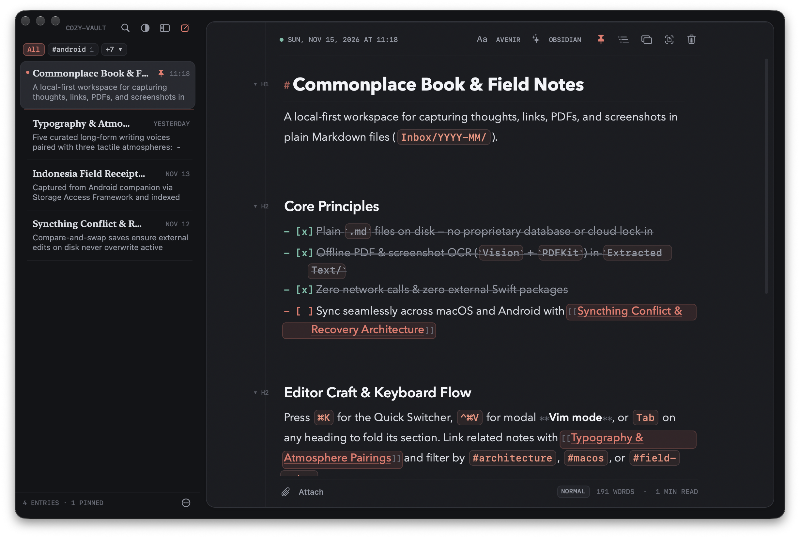

# Cozy Notes

[](https://github.com/rizafahmi/cozy-notes/actions/workflows/ci.yml)
[](https://github.com/rizafahmi/cozy-notes/releases/tag/v0.1.0)
[](LICENSE)

Cozy Notes is a local Markdown note app for macOS with offline search and an optional Android capture companion. Notes (`Inbox/<UTC-timestamp>-<UUID>.md`), attachments (`Attachments/<UUID>/`), and extracted PDF/screenshot text (`Extracted Text/<sha256>.md`) stay on disk as plain files. There are no accounts, cloud services, or network calls.



## Requirements & Install

Requires **macOS 14.0+** on **Apple Silicon (`arm64`)**. Download [`Cozy-Notes-v0.1.0-macOS-14.0-arm64.zip`](https://github.com/rizafahmi/cozy-notes/releases/tag/v0.1.0) and its `.sha256` checksum from [GitHub Releases](https://github.com/rizafahmi/cozy-notes/releases/tag/v0.1.0):

```sh
shasum -a 256 -c Cozy-Notes-v0.1.0-macOS-14.0-arm64.zip.sha256
ditto -x -k Cozy-Notes-v0.1.0-macOS-14.0-arm64.zip .
mv "Cozy Notes.app" /Applications/
```

**First launch (Gatekeeper):** Off-store releases are ad-hoc signed, not notarized. When macOS blocks the first launch, open `/Applications/Cozy Notes.app` once, then open **System Settings → Privacy & Security** and click **Open Anyway** (or **Control-click → Open** in Finder). Do not disable Gatekeeper globally.

## Try It

First launch opens `~/Documents/Cozy Notes` (switch folders anytime with `⌘⇧O`).

- **Capture:** Press `⌘N` to write in the workspace (edits autosave in place), or `⌘⇧Space` from any app for Quick Capture (`⌘Return` saves to `Inbox/`, `Esc` tucks the draft away). Drop or paste PDFs and screenshots into a note, then click **Index** in the sidebar (`File → Make Searchable`) to extract text locally.
- **Find:** Press `⌘P` or `⇧⌘F` to search across notes, attachments, and extracted text, or `⌘F` to find in the active note.

## Android Companion

The optional Android app (`android/`, Android 8.0+ / API 26+) is capture-only. Share text, links, or files to write `Inbox/` and `Attachments/` entries to a local folder, with no search, OCR, or network permission. Sync that folder externally (for example with [Syncthing](https://syncthing.net/)).

## Contribute

Requires **macOS 14.0+** and **Swift 5.9+** (Xcode or Command Line Tools). The macOS target uses native AppKit with no external Swift package dependencies; Android (`android/`) uses AndroidX and requires JDK 17 and Android SDK 35.

```sh
git clone https://github.com/rizafahmi/cozy-notes.git
cd cozy-notes
swift test
scripts/build-macos.sh release
```

`scripts/build-macos.sh release` builds, installs to `/Applications/Cozy Notes.app`, and launches the app (pass `--build-only` to assemble in `.build-app/Cozy Notes.app` without installing).

See [CONTRIBUTING.md](CONTRIBUTING.md) for invariants and the PR checklist, [docs/architecture.md](docs/architecture.md) for storage and sidecar details, and [LICENSE](LICENSE) for the MIT license.
