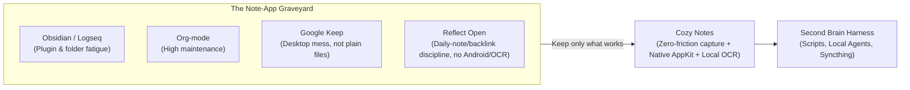

# Cozy Notes: Zero-Budget Open-Source & Build-in-Public Marketing Plan

Cozy Notes has a rare combination of traits that developer and PKM (Personal Knowledge Management) communities love: **opinionated constraints, zero dependencies, extreme performance, and an honest philosophy.**

Most note apps fail because they demand tax upfront—choosing a folder, naming a file, tagging, or maintaining a database. Cozy Notes has a crystal-clear hook: **a second brain for lazy people, built on plain files, that acts as a clean harness for whatever tools or agents you bring later.**

---

## 1. Positioning & Core Narrative: "The Note-App Graveyard"

### The Origin Hook (Your Personal Story)
> **"I tried Logseq, Obsidian, Google Keep, Org-mode, and Reflect. Nothing stuck. I realized the problem wasn't the features—it was that I'm too lazy to be a librarian for my own notes. So I built my own."**

Why this angle works so well:
Almost every developer and knowledge worker has gone through the exact same **PKM cycle of guilt**:
- **Obsidian / Logseq:** Starts exciting, ends with 3 hours tweaking plugins/themes/graphs and feeling guilty about broken templates or messy folders.
- **Org-mode:** Incredible power, but requires living inside Emacs and maintaining rigid syntax/agendas.
- **Reflect (`reflect-open`):** Great open-source move to local Markdown files, but still built around the structured **daily-notes + backlink gardening** discipline (and an Electron/TypeScript stack)—plus no way to quickly dump things from an Android phone or search inside messy screenshots/PDFs.
- **Google Keep:** Frictionless capture on Android, but becomes an unsearchable, non-Markdown sticky-note junkyard on desktop.

**Cozy Notes is the synthesis of what actually worked:** Google Keep's zero-friction capture + Obsidian/Reflect Open's plain local Markdown files + pure native AppKit typography—stripped of daily-note rituals, backlink gardening, and folder chores.

### The Three Narrative Pillars
1. **Built for Recovering PKM Hoppers ("For Lazy People"):** No mandatory titles, no folder trees to groom, no graph view to admire, no daily-note or backlink-gardening ritual. Hit `Cmd+Shift+Space` on Mac (or Share on Android), dump text, links, PDFs, or screenshots into `Inbox/<timestamp>-<UUID>.md`, and get back to work.
2. **The "Second Brain Harness" Thesis:** Not all knowledge is text you type. Because lazy note-takers dump screenshots and PDFs, Cozy Notes automatically generates **deterministic OCR/PDF Markdown sidecars (`Extracted Text/<sha256>.md`)** alongside your `Inbox/` notes. Your folder *is* a self-contained plain-text harness—ready for any script, CLI tool, or local agent you build next.
3. **Uncompromising Native Craft:** Pure programmatic AppKit (zero Electron/TypeScript, zero SwiftUI bloat, zero external Swift packages), Bike-style spring-physics caret, built-in English + Bahasa Indonesia (`id-ID`) OCR, and a **1.2M-character Moby-Dick benchmark suite** (`<8ms` P95 keystroke latency, `<16ms` 60fps window resize).



---

## 2. Pre-Launch Repo Polish (High-Leverage Assets)

Before posting anywhere, the GitHub repository must convert casual visitors into stars and testers within 10 seconds:

1. **Above-the-Fold Visual in [README.md](file:///Users/riza/code/cozy-notes/README.md):**
   - Record a **12-second looping GIF / MP4** showing:
     1. Pressing `Cmd+Shift+Space` over another app to drop a screenshot + messy thought.
     2. Clicking **Make searchable** as Vision OCR turns the screenshot into a plain Markdown companion file in `Extracted Text/`.
     3. Switching between **Obsidian & Ivory**, **Midnight Ink & Porcelain**, and **Neo-Acid & Plaster** atmospheres (`Cmd+Shift+T`).
2. **Pre-Built GitHub Release (plus Homebrew tap or simple build script):**
   - Developers will run `scripts/build-macos.sh release`, but attaching a zipped `.app` (with clear instructions for `xattr -cr` since it's ad-hoc signed) triples try-out rates.
3. **A `VISION.md` or "Why a Harness?" Section:**
   - Explicitly explain where the project is today (fast local capture + OCR/PDF companion files + Android capture companion) and where it's going (a modular harness around plain files for a second brain). People love starring a repo early when they buy into the roadmap.

---

## 3. The "Build in Public" Content Engine

Instead of generic "Version 0.2 released" updates, share **opinionated engineering and product stories**. Every feature in your codebase is already a standalone post:

| Story / Post Angle | Core Hook | Target Audience |
| :--- | :--- | :--- |
| **1. The Lazy PKM Manifesto** | "I got tired of Obsidian plugins and Notion databases. I built a note app where you aren't allowed to organize folders before writing." | r/PKMS, X/Twitter, Hacker News |
| **2. Why OCR Belongs in Plain Markdown Sidecars** | How `CozySearch` extracts text from screenshots & PDFs into `Extracted Text/<sha256>.md` with a base64 HTML comment header—making images searchable by `grep`, Syncthing, and local scripts. | Hacker News, r/LocalLLaMA, Dev.to |
| **3. The "Moby-Dick Workout"** | How you test your AppKit editor by typing and resizing against 1.2M characters of *Moby-Dick* at `<8ms` P95 keystroke latency (`--moby-dick-workout`). | r/swift, r/macapps, Lobste.rs, X |
| **4. The Mac + Android Problem** | "I use a Mac at my desk and an Android in my pocket. Apple Notes isn't on Android, and cross-platform Electron apps feel sluggish. So I built a native AppKit workspace + a capture-only Android SAF companion synced via Syncthing." | r/androidapps, r/macapps, Syncthing forum |
| **5. Designing a "Harness" for a Second Brain** | Why baking AI directly into a note editor ages poorly—and why turning your notes + PDFs + screenshots into a clean filesystem contract is the ultimate second-brain harness. | X/Twitter, Substack / Personal Blog |
| **6. Sweating Invisible Details in AppKit** | Building a critically damped 125ms spring-physics caret (`MarkdownTextView`), heading gutter folding in TextKit 1, and compare-and-swap conflict recovery. | iOS/macOS devs on X, Mastodon |

---

## 4. Channel-by-Channel Zero-Budget Distribution (Indonesia + Global Dual-Track)

> [!IMPORTANT]
> **Should you still target Hacker News and Reddit?**
> **Yes, for global GitHub stars and contributors—but NOT for reaching an Indonesian audience.** Reddit is blocked by default in Indonesia (requiring DNS/VPN), and HN has a tiny Indonesian footprint. However, HN and Reddit are still the fastest zero-budget way to get 500+ GitHub stars globally, which gives you massive social proof when sharing with Indonesian devs and creators.
>
> Use a **Dual-Track Strategy**: **Track A (Indonesia-First)** for community, daily build-in-public engagement, and relatable storytelling; **Track B (Global Dev/PKM)** for GitHub stars and open-source contributors.

### Track A: Indonesian Audience (Where People Actually Hang Out)

You already have a killer built-in local hook: **Cozy Notes natively supports Indonesian (`id-ID`) screenshot OCR out of the box** (`Vision` recognition for English + Indonesian), and the **MacBook + Android phone** combo is the default setup for Indonesian developers and tech workers (unlike the US, where Mac users almost exclusively use iPhones).

1. **X (Twitter) Indonesia (`#TechTwitterID` / Indie Hacker ID circle):**
   - X is still the #1 place in Indonesia for software engineers, designers, and indie makers to discover side projects.
   - **What works:** Casual, honest threads in Bahasa Indonesia (or mixed Indo-English) with a short screen recording.
   - **Hook example:** *"Sebagai orang males rapiin folder di Notion/Obsidian, akhirnya bikin aplikasi notes sendiri buat Mac + Android. Tinggal lempar screenshot (udah support OCR Bahasa Indonesia) & teks, gak perlu mikirin judul."*
2. **Threads (by Instagram) & Instagram Reels:**
   - In Indonesia, **Threads** has exploded among tech workers, product managers, writers, and productivity enthusiasts—often out-engaging X for casual build-in-public stories.
   - **What works:** Conversational text posts about *why* your "second brain" failed before, or 15–30 second aesthetic desk/screen videos showing the `Obsidian & Ivory` / `Neo-Acid` themes in action.
3. **LinkedIn Indonesia (Tech & Engineering Network):**
   - Indonesian engineers and tech leads are hyper-active on LinkedIn, and genuine engineering posts get huge organic reach because most LinkedIn content is generic fluff.
   - **What works:** Share the **engineering craft** behind Cozy Notes—e.g., building a native macOS app with zero dependencies, how you benchmarked 1.2M characters of *Moby-Dick* at `<8ms` latency, or how you solved the Mac + Android sync gap using plain files and Syncthing.
4. **Indonesian Developer Telegram & Discord Groups:**
   - Direct, high-trust communities where sharing open-source side projects is welcomed (in their `#showcase` or `#project` channels):
     - **Telegram:** Swift Indonesia / iOS Dev ID, Kotlin Indonesia / Android Dev ID, MacClub Indonesia, Indie Hackers Indonesia.
     - **Discord / Facebook:** Web Programming UNPAS (WPU) Discord `#showcase`, Programmer Handal / Indo Dev communities.
5. **Short-Form Video (TikTok ID / YouTube Shorts / Reels):**
   - "Aplikasi catatan buat kaum mendang-mending & pemalas (Gratis, Open Source, Mac + Android)."
   - Show a 20-second workflow: taking a screenshot of a receipt/slide in Bahasa Indonesia on Android → syncing via Syncthing → searching the exact Indonesian words on Mac without typing a title.

---

### Track B: Global Open-Source Reach (HN, Reddit, & Directories)

Keep HN and Reddit purely for **English-speaking open-source traction** ( takes ~30 minutes of copy-pasting once your assets are ready):

- **Hacker News (`Show HN`):**
  - Best for getting global developers to star the repo and battle-test your architecture.
  - **Title:** `Show HN: Cozy Notes – Local-first macOS note app for lazy people (AppKit, zero deps, plain files)`
- **Reddit (`r/macapps`, `r/PKMS`, `r/selfhosted`, `r/swift`):**
  - Worth posting if you already have a VPN/DNS setup, purely because `r/macapps` and `r/PKMS` readers aggressively star and review free native Mac apps. If Reddit feels like a chore, skip it and put 100% of your energy into **X, Threads, LinkedIn, and Show HN**.
- **Curated GitHub Lists (Evergreen Traffic, No VPN Needed):**
  - Submit PRs to `awesome-mac`, `open-source-mac-os-apps`, and `awesome-local-first`.

---

## 5. Phased Execution Roadmap

### Phase 1: Open-Source Readiness (Days 1–3)
- [ ] Capture 3 high-DPI screenshots (one per atmosphere) and 1 short demo video for [README.md](file:///Users/riza/code/cozy-notes/README.md).
- [ ] Add an open-source `LICENSE` file (e.g., MIT or GPLv3) and a brief "Roadmap: The Second Brain Harness" section in [README.md](file:///Users/riza/code/cozy-notes/README.md).
- [ ] Create 4–6 `good first issue` tickets (e.g., additional OCR languages, custom harness scripts/hooks, export utilities) so early visitors have an easy way to contribute.

### Phase 2: The Initial Wave (Week 1–2)
- [ ] Publish the introductory blog post / X thread: *"Why I built a zero-dependency macOS note app for lazy people."*
- [ ] Post to `r/PKMS` and `r/macapps` first to gather initial UX feedback and fix any onboarding friction.
- [ ] Launch `Show HN` mid-week (Tuesday–Thursday, ~8:00 AM PT / 10:00 PM WIB) once the README answers every common question from the Reddit threads.

### Phase 3: The "Second Brain Harness" Journey (Ongoing Weekly Cadence)
- [ ] **1 Feature = 1 Story:** Every time you build a harness capability (e.g., a script/hook that summarizes `Inbox/`, auto-links related notes, or exposes the vault to local tools), publish:
  1. The real-world problem you had as a "lazy note-taker."
  2. How the plain-file contract (`Inbox/` + `Extracted Text/`) made it trivial to build without bloating the core app.
  3. A 20-second demo video + link to the commit/release.

---

## 6. Ready-to-Use Launch Drafts ("The Note-App Graveyard" Angle)

````carousel
### Draft 1: Threads / X Indonesia (Conversational Thread)

**Post 1 (Hook + Screen Recording GIF):**
Udah nyobain hampir semua aplikasi notes:
- Obsidian
- Logseq
- Google Keep
- Emacs Org-mode
- Reflect

Ujung-ujungnya gak ada yang bertahan lama. Bukan karena aplikasinya jelek, tapi karena gue terlalu males jadi "pustakawan" buat catatan sendiri.

Akhirnya mutusin bikin sendiri (dan gue open-source): **Cozy Notes**.

**Post 2 (The Problem):**
Polanya selalu sama:
- Pakai Obsidian/Logseq → sibuk ngulik plugin & folder, begitu berantakan malah males buka.
- Pakai Org-mode → powerful tapi ribet maintain-nya.
- Pakai Reflect (`reflect-open`) → keren udah open-source & file lokal, tapi masih menuntut disiplin *daily notes* & rajin nyambungin backlinks (plus belum ada companion buat HP Android atau OCR screenshot otomatis).
- Pakai Google Keep → gampang nyatet di HP, tapi pas dibuka di laptop jadi tempat sampah yang susah dicari.

Masalah tambahannya: gue sehari-hari pakai **MacBook + HP Android**.

**Post 3 (What Cozy Notes Does Differently):**
Jadi gue ambil yang bener-bener kepake aja buat orang males:
1. **Tanpa wajib kasih judul / pilih folder:** Tekan `Cmd+Shift+Space` di Mac (atau Share dari Android), lempar teks, link, PDF, atau screenshot. Beres.
2. **100% Plain Markdown lokal:** Gak ada database aneh-aneh. Sync antara Mac & Android cukup pakai Syncthing.
3. **Bisa baca teks di dalam Screenshot (Support Bahasa Indonesia & Inggris):** Screenshot struk, chat, atau slide otomatis di-OCR jadi file Markdown pendamping (`Extracted Text/`) tanpa internet/API.

**Post 4 (The Vision: Second Brain Harness):**
Saat ini fiturnya sengaja masih basic & fokus ke kecepatan (pure native AppKit di macOS, 0 external dependency, di-test ngetik di dokumen 1.2 juta karakter tetap <8ms).

Goal jangka panjangnya: gue pengen bikin **"harness" buat Second Brain** di atas folder file Markdown biasa ini. Karena semua catatan + hasil OCR bentuknya plain text, kita bebas pasang script/agent apapun di luar aplikasi.

Buat yang mau nyobain, intip kodenya, atau ikut ngulik:
🔗 [Link GitHub]
<!-- slide -->
### Draft 2: LinkedIn Indonesia (Engineering + Product Story)

**Judul / Baris Pertama:**
Saya sudah mencoba Logseq, Obsidian, Google Keep, Org-mode, sampai Reflect. Tidak ada yang bertahan lama. Jadi saya membuat aplikasi catatan sendiri—dan hari ini saya buka sebagai Open Source.

Selama bertahun-tahun, saya pikir masalahnya ada di fitur aplikasinya. Ternyata masalahnya ada di saya: **saya terlalu malas merapikan folder, memberi judul, atau merawat "Second Brain" yang rumit.**

- Di **Obsidian & Logseq**, saya habis waktu mengutak-atik plugin dan struktur folder.
- Di **Org-mode**, kurva perawatannya terlalu tinggi.
- Di **Google Keep**, sangat cepat untuk mencatat di Android, tapi berantakan saat diakses di Mac.
- Di **Reflect (`reflect-open`)**, konsep file lokalnya bagus, tapi tetap menuntut disiplin merawat *daily notes* dan *backlinks* (serta belum menjawab kebutuhan *quick capture* dari Android dan OCR screenshot otomatis).

Sebagai pengguna **macOS + Android**, saya butuh sesuatu yang menggabungkan kecepatan Google Keep, keterbukaan file lokal, dan ringannya aplikasi native Mac (AppKit).

Itulah kenapa saya membangun **Cozy Notes**:
- **Zero-Friction Capture:** Tanpa wajib membuat judul atau memilih folder. Cukup tekan `Cmd+Shift+Space` di Mac atau *Share* dari Android.
- **Plain Files sebagai "Second Brain Harness":** Semua catatan disimpan sebagai file Markdown biasa (`Inbox/`). Gambar/screenshot dan PDF diekstrak secara lokal (mendukung OCR Bahasa Indonesia & Inggris via macOS Vision) menjadi file Markdown pendamping di `Extracted Text/`.
- **Zero Dependencies & Native Performance:** Dibangun murni dengan AppKit (Swift) tanpa dependency eksternal, tanpa cloud/LLM API, dan diuji menggunakan benchmark *Moby-Dick* (1,2 juta karakter) untuk menjaga latensi ketikan di bawah `<8ms`.

Saat ini aplikasinya masih sederhana—namun fondasi file terbukanya dirancang agar ke depannya bisa menjadi **harness untuk Second Brain** yang mudah diotomasi dari luar.

Source code dan rilis awalnya bisa dicoba di sini: [Link GitHub]
Feedback atau diskusi dari teman-teman pengguna Mac/Android sangat diterima!
<!-- slide -->
### Draft 3: Global `Show HN` (Hacker News)

**Title:**
`Show HN: Cozy Notes – I tried Obsidian, Logseq, Keep, Org, and Reflect; nothing stuck, so I built my own (macOS/Android, plain files)`

**First Comment:**
Hi HN,

Over the last few years I’ve cycled through Obsidian, Logseq, Google Keep, Org-mode, and Reflect. None of them stuck.

Eventually I admitted why: I’m a lazy note-taker.
- With Obsidian and Logseq, I spent more time tweaking plugins and feeling guilty about unorganized folders than actually capturing things.
- With Org-mode, the maintenance tax was too high for quick multimedia dumps.
- With Reflect (`reflect-open`), even with local Markdown files, it's still built around daily-note/backlink gardening (and Electron/TypeScript) rather than dumping messy screenshots/PDFs or capturing from Android.
- With Google Keep, capture on Android was frictionless, but it turned into a locked-in junkyard on my Mac.

So I built **Cozy Notes** for people who refuse to curate folders:
1. **Dump first, search by words you remember:** Hit `Cmd+Shift+Space` on macOS (or share from the capture-only Android companion app). Text, links, PDFs, and screenshots land straight in `Inbox/<UTC-timestamp>-<UUID>.md`. No mandatory titles or folder trees.
2. **Readable Markdown companions for OCR & PDFs:** Instead of hiding extracted text in a SQLite database, macOS `Vision` (en-US + id-ID) and `PDFKit` generate deterministic, human-readable Markdown sidecars in `Extracted Text/<sha256>.md`.
3. **Pure AppKit, zero dependencies:** Written in programmatic AppKit with zero external Swift packages, zero network calls, and a built-in 1.2M-character Moby-Dick stress harness (`swift run CozyNotes --moby-dick-workout`) enforcing `<8ms` P95 keystroke latency and `<16ms` window resize.

**Where this is going:**
Right now the app is intentionally minimal. My goal is to build a **"second brain harness"** around this plain-file contract—because when your notes, PDFs, and OCRed screenshots are all clean UTF-8 Markdown files on disk, any external script, CLI tool, or local agent can work on them without an SDK.

Happy to answer any questions about TextKit 1 layout, the spring-physics caret, or the Syncthing-friendly compare-and-swap conflict model!
````
